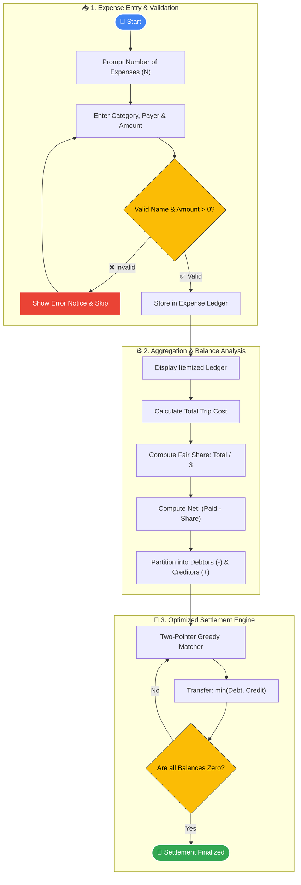
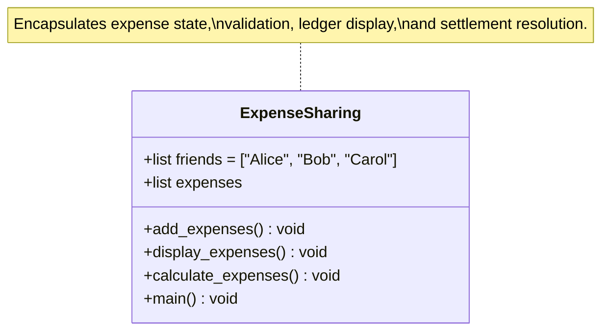

# 💰 Google Pay Expense Sharing System

<p align="center">
  
  
  
  
  
</p>

<p align="center">
  <b>A smart, automated expense tracking and debt settlement engine inspired by Google Pay's split expense functionality.</b><br>
  <i>Calculate shared trip costs, eliminate manual math, and resolve group balances with minimum transactions.</i>
</p>

<p align="center">
  <a href="#-project-overview">Overview</a> •
  <a href="#-key-features">Features</a> •
  <a href="#-system-workflow">Workflow</a> •
  <a href="#-settlement-algorithm">Settlement Algorithm</a> •
  <a href="#-live-execution-preview">Execution Preview</a> •
  <a href="#-quick-start">Quick Start</a> •
  <a href="#-roadmap">Roadmap</a> •
  <a href="#-author">Author</a>
</p>

---

## 📌 Project Overview

When friends travel together, expenses like **accommodation**, **food**, **travel**, and **activities** are paid by different individuals. Calculating who owes whom at the end of the trip often results in messy calculations, confusion, and unnecessary back-and-forth transfers.

The **Google Pay Expense Sharing System** is an Object-Oriented Python application that automates this entire lifecycle:
1. **Logs** each expense along with who paid.
2. **Aggregates** total group expenditure.
3. **Determines** each individual's equal fair share.
4. **Calculates** net balance positions (+ve for creditors, -ve for debtors).
5. **Solves** debt settlements using a **two-pointer greedy matching algorithm** to minimize the number of payment transactions.

---

## ✨ Key Features

| Feature | Visual Icon | Description |
| :--- | :---: | :--- |
| **Interactive Expense Logging** | 📝 | Dynamically input multiple expense items with categories, payer names, and amounts. |
| **Strict Input Validation** | 🛡️ | Validates against registered participants (`Alice`, `Bob`, `Carol`) and rejects non-positive amounts. |
| **Ledger Inspection** | 📋 | Formatted breakdown of all expenses incurred during the trip. |
| **Total & Fair Share Split** | 🧮 | Computes gross total and dynamically divides it equally among group members. |
| **Net Balance Calculation** | ⚖️ | Computes whether each person is a **Debtor** (owes money) or **Creditor** (is owed money). |
| **Optimal Debt Settlement** | 💸 | Employs a greedy two-pointer strategy to clear debts with the minimal number of payments. |

---

## 🔄 System Workflow



---

## 🏗️ Architecture & OOP Design

The core logic is encapsulated within the [`ExpenseSharing`](file:///C:/Users/Lenovo/Documents/Projects - 2/Googlepay expenses sharing/Gpay Expenses Sharing.ipynb#L109-L250) class:



### Module Responsibilities

| Method | Role | Logic |
| :--- | :--- | :--- |
| `__init__()` | **State Initializer** | Initializes participant registry and empty expense ledger. |
| `add_expenses()` | **Data Ingestion** | Loops through $N$ inputs, validating participant name and strictly positive amounts. |
| `display_expenses()` | **Report Generator** | Iterates over ledger and renders itemized summary. |
| `calculate_expenses()` | **Settlement Core** | Computes totals, per-person shares, debtor/creditor lists, and executes greedy settlement. |
| `main()` | **Orchestrator** | Coordinates sequential execution pipeline. |

---

## 🧮 Settlement Algorithm & Case Study

### 1. The Real Trip Scenario Data

| Expense Type | Paid By | Amount Paid |
| :--- | :---: | :---: |
| 🚕 Local Travel | **Bob** | ₹455.00 |
| 🏨 Accommodation | **Carol** | ₹4,000.00 |
| 🍱 Meals | **Alice** | ₹350.00 |
| **Total Trip Expenditure** | | **₹4,805.00** |

$$\text{Individual Share} = \frac{\text{Total Expenditure}}{\text{Number of Friends}} = \frac{₹4,805.00}{3} \approx \mathbf{₹1,601.67}$$

### 2. Net Balance Breakdown

$$\text{Net Balance} = \text{Amount Paid} - \text{Equal Share}$$

| Participant | Amount Paid | Fair Share | Net Balance | Status |
| :--- | :---: | :---: | :---: | :---: |
| 👩 **Alice** | ₹350.00 | ₹1,601.67 | <span style="color:#d9534f">**-₹1,251.67**</span> | 🔴 Debtor (Owes) |
| 👨 **Bob** | ₹455.00 | ₹1,601.67 | <span style="color:#d9534f">**-₹1,146.67**</span> | 🔴 Debtor (Owes) |
| 👩‍🦰 **Carol** | ₹4,000.00 | ₹1,601.67 | <span style="color:#5cb85c">**+₹2,398.33**</span> | 🟢 Creditor (Receives) |

### 3. Greedy Two-Pointer Settlement Execution

Instead of multiple circular transactions, the algorithm pairs debtors directly with creditors:

```
[Debtors Queue]                                  [Creditors Queue]
Alice: ₹1,251.67  ──(Pays ₹1,251.67)───►  Carol (Receives ₹1,251.67, ₹1,146.66 left)
Bob:   ₹1,146.66  ──(Pays ₹1,146.66)───►  Carol (Receives ₹1,146.66, Balance settled!)
```

> **Result:** All balances are settled in just **2 transactions**!

---

## 💻 Live Execution Preview

```text
┌────────────────────────────────────────────────────────┐
│               --- Add Trip Expenses ---                │
└────────────────────────────────────────────────────────┘
Enter number of expenses: 3

Expense 1
Enter expense type (Accommodation/Meals): Travel
Who paid? (Alice/Bob/Carol): Bob
Enter amount: 455
Expense added successfully!

Expense 2
Enter expense type (Accommodation/Meals): Accommodation
Who paid? (Alice/Bob/Carol): Carol
Enter amount: 4000
Expense added successfully!

Expense 3
Enter expense type (Accommodation/Meals): Meals
Who paid? (Alice/Bob/Carol): Alice
Enter amount: 350
Expense added successfully!

┌────────────────────────────────────────────────────────┐
│               --- All Trip Expenses ---                │
└────────────────────────────────────────────────────────┘
Expense Type: Travel
Paid By: Bob
Amount: Rs. 455.0
------------------------
Expense Type: Accommodation
Paid By: Carol
Amount: Rs. 4000.0
------------------------
Expense Type: Meals
Paid By: Alice
Amount: Rs. 350.0
------------------------

┌────────────────────────────────────────────────────────┐
│                --- Expense Summary ---                 │
└────────────────────────────────────────────────────────┘
Total Expense: Rs. 4805.0
Each Person Share: Rs. 1601.67

┌────────────────────────────────────────────────────────┐
│                --- Final Settlement ---                │
└────────────────────────────────────────────────────────┘
✔ Alice should pay Rs. 1251.67 to Carol
✔ Bob should pay Rs. 1146.66 to Carol

==========================================================
🎉 ALL EXPENSES BALANCED AND SETTLED SUCCESSFULLY!
==========================================================
```

---

## 📂 Project Structure

```bash
Google-pay-Expense-Sharing/
├── Gpay Expenses Sharing.ipynb    # Main Jupyter Notebook containing OOP implementation
└── Readme.md                      # Comprehensive visual documentation
```

---

## 🚀 Quick Start

### Prerequisites
- Python 3.8+ installed ([Download Python](https://www.python.org/downloads/))
- Jupyter Notebook or VS Code with Jupyter Extension

### 1. Clone the Repository
```bash
git clone https://github.com/mmsameer2006/Google-pay-Expense-Sharing.git
cd Google-pay-Expense-Sharing
```

### 2. Install Jupyter
```bash
pip install notebook
```

### 3. Launch Notebook
```bash
jupyter notebook "Gpay Expenses Sharing.ipynb"
```
*Or open the notebook directly in Visual Studio Code and click **Run All Cells**.*

---

## 🔮 Roadmap

- [x] Object-Oriented expense engine
- [x] Two-pointer greedy settlement algorithm
- [x] Input validation for payers and amounts
- [ ] 👥 Dynamic participant support (add $N$ custom friends)
- [ ] ⚖️ Unequal / Percentage split ratios
- [ ] 🖥️ Interactive GUI dashboard (Streamlit / Kivy)
- [ ] 🗄️ Database persistence (SQLite)
- [ ] 📄 PDF Receipt / Invoice export
- [ ] 🔗 Direct UPI / Google Pay deep-linking for instant settlements

---

## 👨‍💻 Author

<p align="left">
  <b>Mohamed Sameer M</b><br>
  <i>B.Tech – Artificial Intelligence & Data Science</i>
</p>

[](https://github.com/mmsameer2006)

---

<p align="center">
  <b>⭐ Star this repository if you found it useful! ⭐</b><br>
  <sub>Built with ❤️ and Python</sub>
</p>
